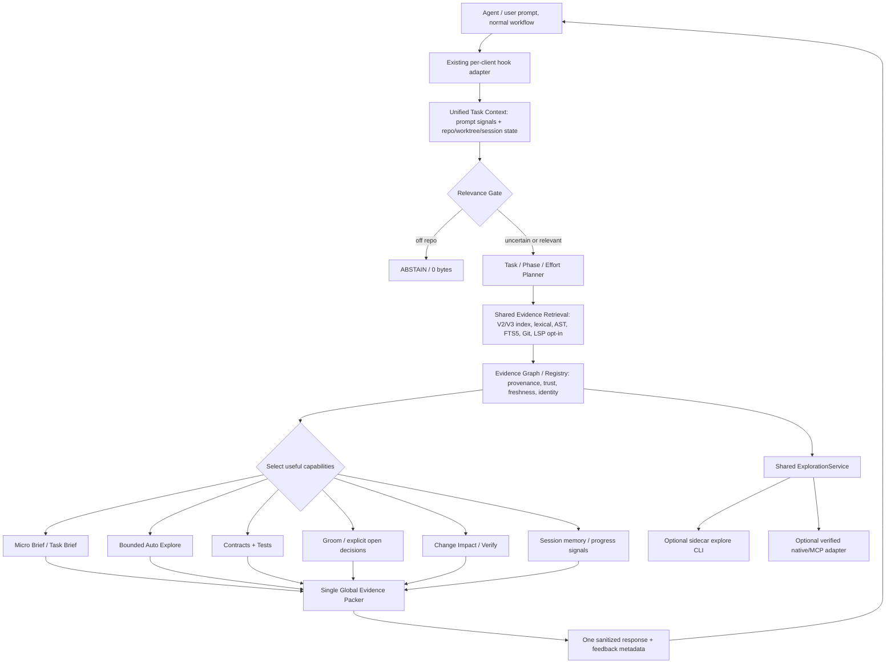

# Sidecar V3.5 — Unified Context Engine

**Status:** architecture proposal / implementation contract, **NOT implemented**. Based on `main@16aa8f68187bf0de9781f2d0a333ffde91713b90` (V3, PR #21), 2026-11-09. See [delivery plan](implementation-plan.md) and [measurement contract](evaluation.md).

> **Product intent:** Sidecar is an invisible, local, deterministic engineering-assistance layer beside coding agents. Installation is once per user. The agent must benefit automatically from the context it receives, without needing to learn a Sidecar CLI, workflow, prompt language or skill. The CLI is an additional lens, not the main product.

## 0. Explicit non-goals and invariant contracts

- **Keep V1/V2/V3 and all V3 work** (index/AST/FTS5/Git/lexical/graph, RelevanceGate, EffortRouter, Brief, Explore, Groom, Impact, Memory, Session Intelligence, Studio, adapters, feedback, LSP integration and lab). **Unify**, don't restart, duplicate indexers or silently erase a working feature.
- Never require a network, hosted API, LLM, embedding model, server, daemon or MCP to obtain core benefits. No boilerplate/`AGENTS.md` written into the user's repo. Local-first, portable, reversible installation, low latency and safe fail-open hooks.
- Repository content, tool results and docs are **untrusted evidence**, never instructions that overrule the user or the agent. Do not execute repo code to retrieve evidence, leak data in logs or change the original user prompt.
- No blanket "all features on" runtime mode: features share **one evidence budget** and are selected by relevance, task phase and measured marginal utility. **Always available** does not mean **always injected**.
- No benchmark victory claims until real matched agentic experiments. No tuning on sealed holdout; never turn a missing cost into zero.
- No fictitious mid-turn interventions: if a client offers only UserPromptSubmit, Sidecar can provide context **on prompt** and optionally via an agent-initiated call; it cannot secretly insert output between arbitrary tool calls. Observe hooks are passive unless the specific client transport has been independently validated.
- No unsafe agent command autopilot: automatic exploration reads code/SQLite/Git metadata only, never invokes shells/tests or makes repo changes.

## 1. Grounded assessment of the current code

| Existing component | Code today | Integration defect to solve, not a removal request |
|---|---|---|
| Hook orchestration | `internal/app/app.go::answer` opens index, performs bounded sync, runs `engine.Run` for V3, then `attachDecisions`/`applyGroom`/`applyImpact` (feature gates), then renders | Decision/packer run **before** some enrichment; guidance is appended outside the common allocation budget. |
| V3 gate/router | `internal/engine/engine.go` on top of `retrieve.Search` V2; `ABSTAIN/LEAN/BRIEF/EXPLORE_AVAILABLE/VERIFY`, confidence and budget | Currently classifies the initial prompt, not a shared task/session state or post-edit phase. `CLARIFY` exists as action but is not the integrated policy. |
| Task Brief | `internal/brief/task.go::TaskItems` and `internal/engine/render.go`; currently feature-gated by `SIDECAR_FEATURES=brief` | When a Brief applies it **replaces** routine evidence sections instead of composing a small summary **beside** selected code/relations. Does not know global allocation. |
| Explore | `internal/explore/explore.go` via `sidecar explore`; V3 hook adds an "ON DEMAND" instruction | Agent must elect to learn and call a nonstandard command. The engine should reuse the **exploration core automatically** for suitable tasks; CLI stays available. |
| Grooming | `internal/app/groom.go`, `internal/groom` | Optional question/assumption is separate policy and may spend tokens outside the router budget; must preserve answer/TTL semantics. |
| Impact | `internal/app/impact.go`, `internal/impact` | Runs on uncommitted changes; needs task/phase-aware policy and a single renderer with confidence and clear “suggested vs executed”. |
| Session & Memory | `internal/app/observer.go`, `internal/brief/session.go`, `internal/app/memory.go` | Observer is passive and records hashed signals. Brief has emitted-item state; Memory has decisions/TTL. Coordinate **one session view**, without moving private code/prompts into persistent telemetry. |
| Renderer | `internal/ctxbuild/ctxbuild.go` sections, `internal/brief` | Dedup already exists. Enhance a **single allocation and rendering pass** preserving existing escaping, sanitization, provenance and session fingerprints. |
| Clients/install | `internal/adapter`, `internal/install`, `internal/app/observer.go` | Claude/Codex/Antigravity do not expose identical hook events; runtime must degrade honestly and independently of agent capability. |
| Lab | `bench/lab` and `bench/v3` | E1 V3 reduces FPs/tokens but loses 67.5→57.5% Hit@5 on short internal domain prompts; E2 offline Explore 22/26 facts vs CodeGraph 24/26. No V3 agentic win yet. |

### User-facing principles: two complementary paths

**A. Zero-knowledge Autopilot (DEFAULT target once validated):** Hook receives normal task -> local read of already-indexed repo -> select evidence and optional bounded automatic structural expansion -> emit one coherent small block. Agent uses existing workflow (Read/Edit/Test) without a Sidecar command. A one-line **capability hint** is optional and only shown when evidence is probably insufficient and the client genuinely supports invoking the command. If absent, core remains useful.

**B. Deepen on demand (OPTIONAL):** `sidecar explore` remains a thin CLI client of the same `ExplorationService`. Adapters may expose it through a native tool or MCP **only when supported and tested**; neither adapter nor MCP is required for installation, function or correct fallback. No second retrieval ranking, no second graph and no extra task state.

**Avoid a false dichotomy:** Autopilot is cheap and incomplete by design; on-demand requests can be deeper. The success metric is task completion, not whether the agent ever used the CLI.

## 2. Target architecture



The actual implementation should be a **bounded synchronous decision** at a real hook event and a separate reusable exploration function. The arrows above are logical stages, **not new OS services** or an infinite loop. State updates happen through existing hook/observe events and next real invocation.

## 3. One TaskContext / one evidence ledger

Build an in-memory **task snapshot** combining stable inputs; persist only bounded safe metadata. Do **not** create a second user-repo database or store prompts/code:

```go
// Illustrative contract, NOT an instruction to duplicate these structs verbatim.
// Reuse existing retrieve.Result, engine.Decision, brief.SessionSignals, store APIs.
type TaskContext struct {
    RepoRoot string      // current discovered worktree
    SessionID string     // optional; never assumed available
    QuerySignals TaskSignals
    Phase TaskPhase      // explore | decide | edit | verify | resume | unknown
    Observability Observability // which events are actually reliable for the client
    WorktreeRevision string // HEAD+dirty fingerprint; changes invalidate decisions
    Evidence []EvidenceRef
    Guidance []GuidanceProposal
    Uncertainties []Gap
}
type EvidenceRef struct {
    Key, Fingerprint string
    Path string
    LineStart, LineEnd int
    Origin string     // exact | lexical | AST | LSP | Git | contract | session | graph
    Confidence string // VERIFIED | CANDIDATE | UNKNOWN
    Freshness string  // current | stale | unknown
    CostEstimate int
}
type GuidanceProposal struct {
    Kind string        // BRIEF | OPEN_DECISION | VERIFY_HINT | IMPACT | LOOP_HINT
    EvidenceKeys []string
    Priority int
    TokenEstimate int
    DeliveryReason string
}
type OutputPlan struct {
    Action string
    Phase TaskPhase
    BudgetTokens int
    MaxItems int
    Sections []SectionAllocation
    NotDelivered []Reason
    ExploreCapability string // available/unsupported/unverified; not advertised blindly
}
```

Rules:
1. **Single canonical identity:** file+symbol+line hash+index/worktree generation; dedup same facts even when Brief, Explore, Contract and Impact all name them.
2. **Explicit scope:** worktree, session ID and git version. Never mix two worktrees; stale index means revalidation or clear `UNKNOWN`.
3. **Trust:** only index/AST/LSP resolution substantiates `VERIFIED`, not an LLM guess; caller-by-name without import resolution is `CANDIDATE`; lack of tests means `not located`, not `untested`.
4. **Evidence ≠ advice:** store facts separately from recommendations. `OPEN_DECISION` is a suggestion; only explicit user choice can become a decision.
5. **One read per selected provider in a hook:** feature modules propose lightweight items from an evidence snapshot, not run their own full repository search/index. Heavy additional exploration is conditional and bounded.
6. **Observability is three-valued** (seen / not-seen / unsupported). Missing tool hook ≠ no tool usage; lack of an event cannot become a loop claim.

## 4. One task-aware, phase-aware planning policy

Sequence:

1. Cheap prompt signals; **off-topic** -> zero evidence/zero repo retrieval where confidence justifies it. Preserve uncertain positive prompts.
2. If likely repo task, open/sync existing index only as required; retrieve a **shared base pool** and verify anchors. Prefer recall for short domain-specific PT-BR prompts; don't infer “off topic” from low generic-language overlap alone.
3. Classify phase from **facts available now**: `EXPLORE` (locate/understand), `DECIDE` (high-impact unresolved option), `EDIT` (implement), `VERIFY` (known change or test failure), `RESUME` (after real compaction/interruption), `UNKNOWN` otherwise. Phase does **not** require lifecycle enforcement on the agent.
4. Assign capability values and costs. Run cheap providers first. `MicroBrief` takes 2–4 structured facts when enough information exists; `AutoExplore` only for complex or low-sufficiency navigation and **within remaining latency/byte budget**; `Groom` only for user-decision ambiguity that is *not answerable from repo*; `Impact` when a genuine diff and task relevance exists; `Session` for stale/repeated context or verified loop.
5. Deduplicate and pack **once** using section priorities and a shared token budget. Return a single block, or abstain. Store lightweight decision trace for diagnostics/benchmark; do not log raw prompt/content.
6. Observe post-tool events passively when supported. Update session state so **next actual hook** uses observations. Do not fabricate delivery between tool invocations.

### Suggested activation matrix (initial hypotheses, must be ablated)

| Task/phase | Default small block | Conditional enrichment | Suppress |
|---|---|---|---|
| Greeting/off-topic | Nothing | Nothing | All features |
| Simple locate | 1–2 paths/verified symbols, maybe 1 line of orientation | No deep explore unless evidence demonstrably weak | Groom/Impact/loop |
| Explain code flow | MicroBrief + core location + 1 relation | Bounded AutoExplore when multi-hop question; on-demand only if supported | Full Impact unless a change exists |
| Narrow edit/debug | 2–4 line task brief + **selected source** + relevant test/contract | Bounded relations; errors/failed tests if observed | Repeated docs/verbose branch lists |
| Multi-file/contract edit | Brief + minimal code + dependency/contract/test pointers | AutoExplore (callers/consumers), high-risk uncertainty check | Generic boilerplate |
| Genuine unresolved user choice | Brief + one precise question with actual alternatives and implications | Save answer bounded to session/file hash; defer incompatible implementation guidance | Repeated questions, invented answers |
| After diff or failed test | Delta-aware Brief + Impact findings + test recommendations | Minimal changed-file consumers and verified contract details | Pretending suggested tests ran |
| Resume after compaction | Changed/new evidence + concise state summary from verified metadata | Recover invalidated evidence upon request | Copying old entire brief or transcript |

**Brief design:** use a compact **task orientation header** when it adds value; pair it with **minimal code snippets/relations** rather than automatically dropping every non-Git section as `brief.TaskItems` does today. Pick from a scored pool under one budget, so a statement already in the Brief does not appear a second time under CODE. Full Brief may remain an ablation; orientation is not mandatory on every prompt.

**Example — not exact future output:**

```text
[SIDECAR CONTEXT]
Repository evidence only; verify before relying on it.
TASK BRIEF
- Goal: fix route resolution without changing the public handler signature.
- Entry: router/serve.go:91 (VERIFIED); consumers: api/routes.go:40 (CANDIDATE).
RELEVANT CODE
- router/serve.go:91-103: [a few actual, numbered source lines, not a whole file]
CONTRACTS & TESTS
- router/serve_test.go:26 references the route behavior (VERIFIED).
OPEN DECISION
- None; no question unless a material ambiguity remains.
VERIFICATION
- Suggested: test route escape handling; not executed.
[END SIDECAR CONTEXT]
```

The example is a target format, **not** evidence that those files exist.

## 5. Shared ExplorationService: automatic + optional CLI

`internal/explore/explore.go::Run` already accesses the existing store, retrieval, relations, contracts and impact. Extract **one read-only service with a shared result contract**, keeping `sidecar-explore/1` stable. CLI becomes an adapter to it.

- `QuickExpand`: synchronous, very small, based on top verified anchors; return the **minimum relevant call path and source snippet** (or explicit gap). The unified planner decides whether to run it automatically; no agent command.
- `DeepExplore`: present on-demand CLI or validated client-native tool; wider traversal with strict max files/chars/depth/calls and deterministic tie-breaks; reuse `QuickExpand` algorithms and cache. No implicit unlimited traversal.
- `Freshness-aware request key`: repo/worktree, revision, query concepts, chosen anchors, scope/budget, extraction version; invalidated by file change/branch/compaction where relevant.
- `One ranking and provenance source`: reuse current `retrieve.Search`/`store`, avoiding competing BM25/indexers. Explore results and initial hook share the evidence registry and confidence definitions.
- `Never require tool discovery`: run a bounded amount automatically for high-value prompts. If a client cannot invoke `sidecar explore`, never spend a token asking it to do so. If it can, advertise a compact on-demand hint only when useful. A hint is not a substitute for complete initial assistance.
- **Coverage gaps to work on:** Monolog `handle`→`write`, Sinatra `route!`, Click `parse_args`; use confirmed edges, bounded callers/callees, body windows and documented fallback for dynamic calls. Existing E2 offline: Sidecar 22/26 facts, CodeGraph 24/26; the goal is less end-to-end agent work, not simply chasing 26/26 with giant payloads.
- **Latency guard:** `QuickExpand` runs within the remaining hook budget; on timeout/error, omit safely with a reason and keep the base evidence. Do not spawn a hidden long-running process promising later delivery.

## 6. Session Intelligence as selection feedback (not a separate prompt generator)

Extend existing `brief.SessionSignals` and `app.Observe` with **bounded, non-sensitive** indicators: last rendered evidence IDs/fingerprints, known changed files, confirmed stage, last successful tests if observed, repeated read/search patterns, pending clarifications and compact epoch. Respect existing separate TTL for explicit decisions.

Use these signals to adjust **priority**:
- Don't resend evidence already emitted in same epoch unless file changed, agent explicitly requested it or compaction occurred.
- Repeated reads of a named file can indicate insufficient source allocation; future **actual hook** prioritizes relevant code snippets, not an unsound “you're looping” warning.
- Known diff + test failure -> prioritize actual failure and verification rather than another generic initial task brief.
- If no observable progress, do not intervene, and mark `unobserved`.

**No behavioral claim without E2E:** `internal/app/observer.go` currently sees tool hooks but does not inject advice on tool events; do not turn that into a promise of proactive interruption. A client-specific enhanced transport may be added behind a flag only after documented event semantics, performance limits and E2E agentic benefit.

## 7. Global Evidence Packer (single injection transaction)

Replace the current **append-then-render** pattern with: `collect -> propose -> reserve -> deduplicate -> allocate -> sanitize -> render -> commit state`. This does not eliminate `ctxbuild`; it extends it.

| Priority band | Examples | Rule |
|---|---|---|
| P0 safety and explicit user constraint | User-set decision, contract conflict, mandatory gap that changes behavior | Very short; no unrelated warnings |
| P1 location and essential code | verified entry, minimal actual snippet | Usually more useful than a duplicate summary |
| P1 orientation | micro-brief goal, surface, known test | Include only with enough confidence, no invented goal |
| P2 risk/verification | diff impact, targeted tests, known failures | Only if relevant to current phase |
| P3 optional breadth | more callers, Git history, distant symbols, CLI hint | Drop first when near budget |

Budget is shared by all evidence/guidance and includes **frame, section headings and tool hints**. Proposed starting policy, **not yet a tuned optimum**:
- `ABSTAIN` 0 tokens;
- `LEAN` ~150–350;
- `EDIT/DEBUG` ~350–700;
- `COMPLEX CONTRACT/MULTI-FILE` ~500–1200;
- `AUTO EXPLORE` consumes remaining budget or a separate internal compute budget but never silently bypasses the visible token cap.

Budget controls belong to actual output, not pre-render estimates alone; record actual estimated tokens of the final sanitized block. Tight budget => **no double reporting of a fact**. Provenance/qualifiers survive truncation. If a high-priority field doesn't fit, flag gap (when possible) rather than inventing correctness.

Render in a single shared canonical order: `TASK BRIEF / RELEVANT CODE / RELATIONS / CONTRACTS & TESTS / OPEN DECISION / CHANGE IMPACT / VERIFICATION / GAPS`, omitting empty sections. Maintain existing hook syntax marker, safety sanitizer, output schema compatibility or explicit versioning.

## 8. Integration plan by actual package / API boundary

- `internal/app/app.go`: change to an orchestration entry that owns **one** engine transaction rather than appending feature notes after packing. Keep existing adapter, index sync, panic/fail-open, budget and logging. No extensive business logic inside `app`.
- `internal/engine`: orchestration/planner typed state and decisions; existing `RelevanceGate`/`EffortRouter` intact, extend with phase-aware policy. `SIDECAR_ENGINE=v3.5` is **proposed**, not implemented.
- `internal/retrieve`: continue V2 core, fusion, strict/exact controls, deterministic ordering; no parallel retrieval stack. Resolve L15 using a fresh independent set before gate changes.
- `internal/explore`: expose `QuickExpand`/`DeepExplore` over same primitive. Keep existing CLI and `sidecar-explore/1` result contract.
- `internal/brief`: expose structured task lines and session fingerprints; don't force replacement of code sections.
- `internal/groom`, `internal/impact`, `internal/app/memory.go`: expose **proposal generation** with provenance and estimated cost, keep validation/pending TTLs and semantics. Don't let a feature insert bytes after allocation.
- `internal/ctxbuild`: extend to typed items, priority, global budget, dedup and item-level output accounting; preserve escaping, indicators and output compatibility.
- `internal/app/observer.go`, `internal/progress`: only validated signals as input to next hook; session rev/epoch invalidation and privacy.
- `internal/adapter`/`internal/install`: transport capability matrix, client-independent automatic hook and optional native tool; preserve backups and uninstall.
- `bench/v3`, `bench/lab`: add ablation and task-level evidence coverage with matched baselines; code changes demand tests.

## 9. Performance, failure and privacy contracts

- All parts share a single worktree-scoped DB snapshot and bounded lookup. No duplicate full `index.Sync` in Brief/Explore/Impact; no full graph traversal on every prompt.
- **Hook budgets:** preserve existing timeout and fail-open limits; profile cold/warm; cover concurrency, index locked, partial sync, worktree rename, branch switch, language grammar missing, no Git, broken LSP, stale paths.
- **Safety:** data in code comments/README cannot become commands to the agent; no shell execution, no uncontrolled file traversal, no external endpoints; redaction/hashing for logs; no cache of raw prompts.
- **Correctness:** candidate relation never escalates to verified without evidence. Test suggestions must be explicitly tagged `not run`; the client may run tests independently.
- **Capability availability:** optional client tool only if demonstrably reachable in that agent's actual environment; no automatic advertisement based merely on `os.Executable()`.
- **Compatibility:** V1/V2/V3 unchanged in behavior except narrowly justified and regression-tested fixes; V3.5 opt-in until successful holdout and E3 quality/cost gates.

## 10. Required output from this design

This document is a **specification**, not a delivered engine. Implementation sequencing, per-PR acceptance and migration appear in [implementation-plan.md](implementation-plan.md). Evaluation and comparisons in [evaluation.md](evaluation.md). Preserve [the V3 record](../v3/progress.md) as factual baseline: the V3 E1 trade-offs and E2 offline facts are not superseded by this design.

**Release condition:** users can install once, ask normal coding questions, and obtain an automatically composed small, relevant and actionable task context; optional deep exploration remains available without becoming a learning burden. The benchmark must prove quality preserved and net cost/time benefit.